<p align="center"></p>
<h1 align="center">Smarter Streets. Stronger Cities.</h1>
<p align="center">CIVIQ AI V2 · Southampton civic infrastructure prototype</p>

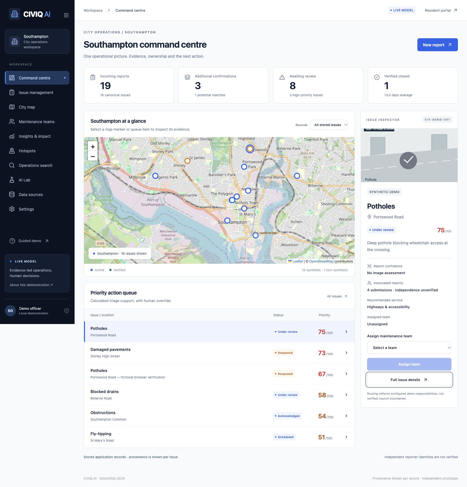

CIVIQ connects resident photographs, reviewed duplicate matches, team assignments, repair evidence and public tracking in one persistent application. V2 upgrades the existing Next.js/SQLite repository with a navy/slate/blue interface, genuine local SigLIP image inference and MiniLM description embeddings. No paid model API key is required.

**Independent experimental prototype.** It has no live council complaint integration. Seed issues are fictional. User reports, historical records, official aggregate statistics and international evaluation images carry separate provenance. Model suggestions support human review; they do not establish asset identity, electrical failure or repair safety.

## Run locally

Node 22 and Python 3.12 were tested. Python 3.10+ is required by the setup script. Run from the repository root:

```sh
npm ci
cp .env.example .env  # only for a new checkout; preserve an existing .env
npm run db:setup
npm run ai:setup      # creates .venv, installs dependencies, downloads pinned weights
npm run data:download # optional licensed evaluation photographs
npm run data:register
```

Run these in separate terminals:

```sh
npm run ai:start      # loopback FastAPI on port 8001
```

```sh
npm run dev           # Next.js on http://127.0.0.1:3000
```

Open `/dashboard/ai-lab`, select **Load cached models**, wait for READY, then run a sample or upload a test image. LIVE MODEL is displayed only after models have loaded and a genuine prediction has been observed. Without the Python service, the resident wizard still accepts manual classification and reports the analysis as unavailable. Settings can explicitly switch to **DEMO MODE**, which uses labelled text rules.

`PYTHON_BIN=/path/to/python3.12 npm run ai:setup` selects a Python installation. Installation/download requires internet access; inference uses cached files by default. Allow a few GB of free disk space for the Python environment as well as weights. Linux's standard PyTorch package may include additional accelerator dependencies; CPU wheel installation can reduce the environment footprint. `MODEL_DEVICE=auto npm run ai:start` selects CUDA/MPS when available; CPU is the default and the verified environment.

`db:setup` deploys additive migrations, runs idempotent seed creation and registers provenance. It does not reset existing issues. Back up `prisma/dev.db` and `data/uploads` together before upgrading a deployed installation. See [the baseline audit](docs/V2-AUDIT.md).

## Implemented workflows

| Area           | V2 behaviour                                                                                                                                                                                                                    |
| -------------- | ------------------------------------------------------------------------------------------------------------------------------------------------------------------------------------------------------------------------------- |
| Resident       | Five steps: photo → location → details → check existing reports → submit; desktop drop zone, mobile camera/gallery, optional access impact, category correction, explicit duplicate confirmation, persistent tracking/reopening |
| Command centre | Collapsible navy sidebar, current stored KPIs, selectable map/queue and contextual evidence inspector with assignment controls                                                                                                  |
| Local vision   | Pinned SigLIP weights analyse actual JPEG/PNG/WebP images; candidate logits and sigmoid similarities, timestamps, duration, configurable threshold/margin, abstention and recorded corrections                                  |
| Matching       | MiniLM cosine similarity plus geographic distance, category and age; explicit keyword fallback if embeddings fail; distinct asset-ID safeguard and officer review preserve original submissions                                 |
| Operations     | Team responsibilities, reassignment, priority breakdown/overrides, lifecycle controls, private notes, repair evidence, filtered database search and source-separated hotspot concentrations                                     |
| Repair review  | Side-by-side photographs and optional SigLIP image cosine support; officer decides closure; failed comparison returns insufficient evidence                                                                                     |
| Data           | Reviewed JSON manifests, CSV/JSON record files, labelled image directories and allowlisted HTTPS endpoint imports; idempotent original IDs, explicit licensing and source metadata                                              |
| Observability  | AI Lab shows actual model/device/loading state, stored analyses, service observations, corrections and dated measured evaluation; Data Sources shows provenance and import status                                               |
| Budget         | Editable assumptions and observed database counts seed an illustrative savings scenario; costs and savings are not measured outcomes                                                                                            |

Existing tracking references, uploads, database IDs and migration history are retained. Local browser test reports are identified as fictional in their descriptions. Anonymous reporter identities are not verified; associated submissions are never claimed to be verified independent people.

## Architecture

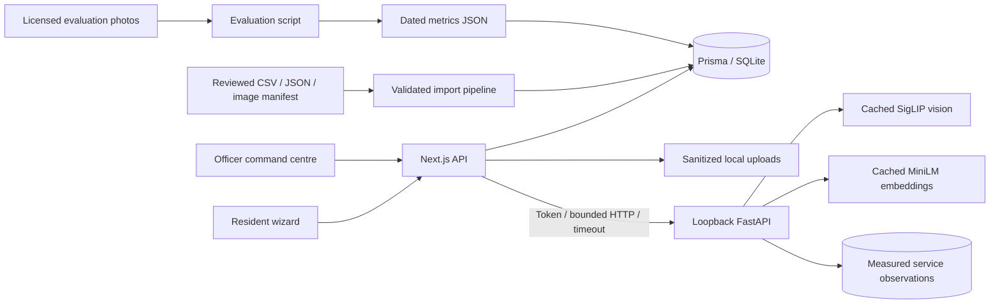

The web application uses Next.js 16, React 19, strict TypeScript, Prisma 6/SQLite, Leaflet and Recharts. FastAPI loads each model once when requested, caches weights, limits work to one inference at a time and keeps a bounded text-vector cache. The application also caches description vectors and successful photograph analyses. Images are decoded, metadata stripped and resized; inputs are limited to 5 MB / 25 million pixels. Search and issue coordinates have database indexes. Hotspots count canonical issues rather than repeated reports and keep source classifications separate.

## Models and measured evaluation

| Model                                                                                                   | Pinned revision                            | Licence    | Downloaded snapshot bytes on this machine |
| ------------------------------------------------------------------------------------------------------- | ------------------------------------------ | ---------- | ----------------------------------------: |
| [google/siglip-base-patch16-224](https://huggingface.co/google/siglip-base-patch16-224)                 | `7fd15f0689c79d79e38b1c2e2e2370a7bf2761ed` | Apache-2.0 |                               815,876,043 |
| [sentence-transformers/all-MiniLM-L6-v2](https://huggingface.co/sentence-transformers/all-MiniLM-L6-v2) | `1110a243fdf4706b3f48f1d95db1a4f5529b4d41` | Apache-2.0 |                                91,617,680 |

The measured environment was Python 3.12.14, PyTorch 2.14.1, Transformers 4.57.6 on macOS CPU with up to four Torch threads. First observed raw-photo classification took 596 ms; subsequent times vary with image size, hardware and contention. AI Lab reports observed service means, not promised latency. Downloads took approximately 151 and 18 seconds on this connection; these are observations, not setup guarantees.

`npm run ai:evaluate` executes actual inference against the four declared Commons photographs and registers the resulting dated metrics. The checked-in [evaluation result](docs/evaluation/v2-smoke-evaluation.json) measured 4/4 correct across two pothole and two graffiti images, macro F1 1.0; the majority-class baseline scored 2/4, macro F1 0.333. **Four convenience images are a smoke test, not evidence of general civic accuracy.** There is no holdout set, independent human label adjudication, Southampton image evaluation or coverage of the remaining classes. Images and weights stay out of Git; attribution and download scripts are tracked.

SigLIP scores are raw logits and sigmoid similarities, not calibrated probabilities. Thresholds and comparison cutoffs are experimental. Daylight lamp photographs cannot establish electrical outages. Repair similarity is sensitive to viewpoint and lighting and cannot establish safety.

## Southampton evidence and imports

The [Southampton Data Observatory Waste page](https://data.southampton.gov.uk/place/environment/waste/) reports **47.1 fly-tipping incidents per 1,000 residents in 2024/25**, updated 29 June 2026 and verified on 17 October 2026. It is official aggregate context, not a geolocated issue feed. No unverified incident total is displayed. The broader source reuse licence remains unverified, so only the attributed factual statistic is registered; bulk redistribution is not claimed.

[Data provenance](docs/DATA-PROVENANCE.md) records all four image sources, licences, dates and limitations. No Kaggle or RoadDamageDetector images were imported without verified access and licensing. There are currently **no imported real geolocated Southampton council issues**.

```sh
npm run data:import -- --manifest reviewed-manifest.json
npm run data:import -- --manifest source.json --records records.csv
npm run data:import -- --manifest source.json --records records.json
npm run data:import -- --manifest source.json --images /path/to/category-directories
npm run data:import -- --manifest source.json --url https://data.southampton.gov.uk/example.json
```

The examples describe supported command shapes; the example endpoint is not a configured feed. Directory imports register evaluation metadata/relative paths only and receive no coordinates; they do not automatically run evaluation. The included evaluation runner and AI Lab sample buttons target the declared Commons manifest. Public endpoints must match the code's HTTPS allowlist, do not follow redirects and require supplied reviewed metadata. The Data Sources page also accepts a reviewed manifest file or pasted JSON. The importer requires an approved licence identifier and explicit `licenceReviewed: true`; an operator remains responsible for reviewing the actual source terms. Aggregate/evaluation imports cannot acquire issue coordinates. Historical issues require supplied Southampton coordinates, description/category/location and reference dates; they remain labelled historical.

## Verification and screenshots

```sh
npm run lint
npm run typecheck
npm test
npm run ai:test
npm run build
npm run test:e2e
```

Application tests use disposable test databases. Playwright uses `prisma/e2e.db`, port 3001 and an offline inference endpoint, preserving the working database. GitHub Actions runs lint, strict TypeScript, application tests, Python inference tests, production build and Chromium workflows. Heavy model weights are not downloaded in CI. See [V2 verification evidence](docs/V2-VERIFICATION.md), [baseline V1 evidence](docs/VERIFICATION.md) and the [three-minute demo](docs/DEMO-SCRIPT.md).

| Resident and evidence                                                  | Operations                                          |
| ---------------------------------------------------------------------- | --------------------------------------------------- |
| 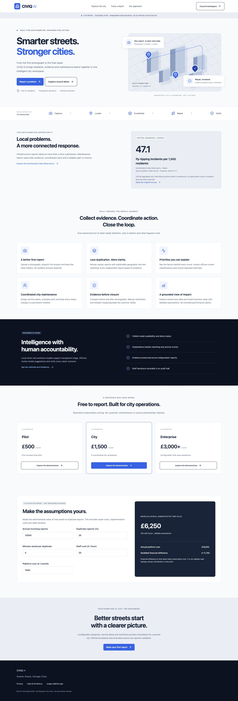                            | 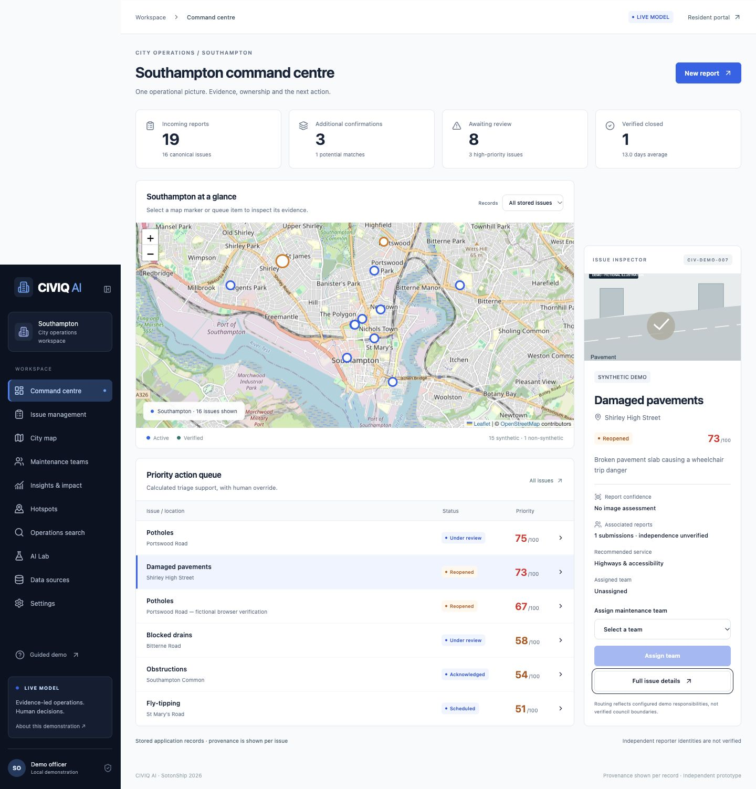 |
| 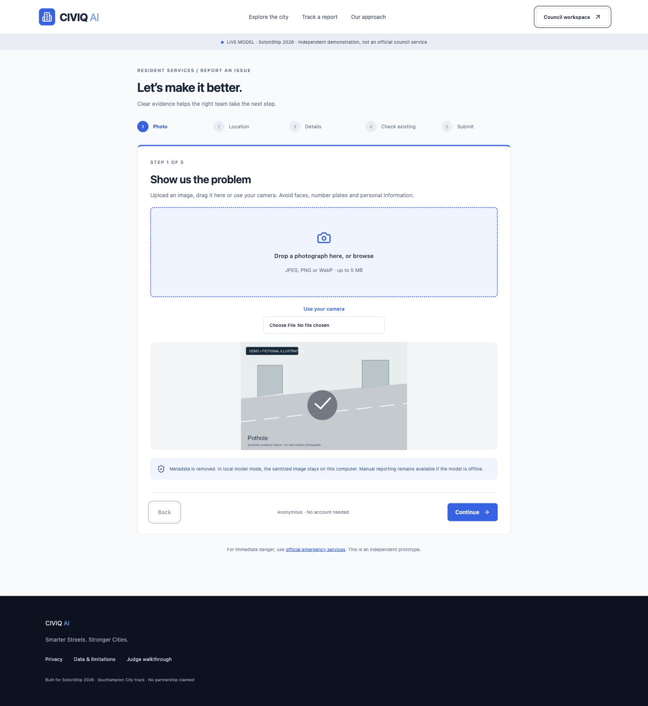                              | 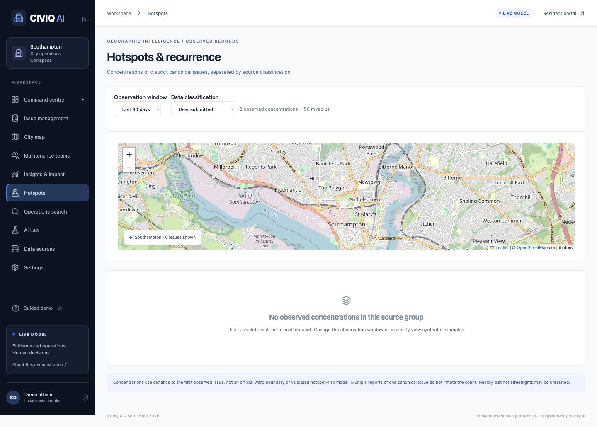       |
| 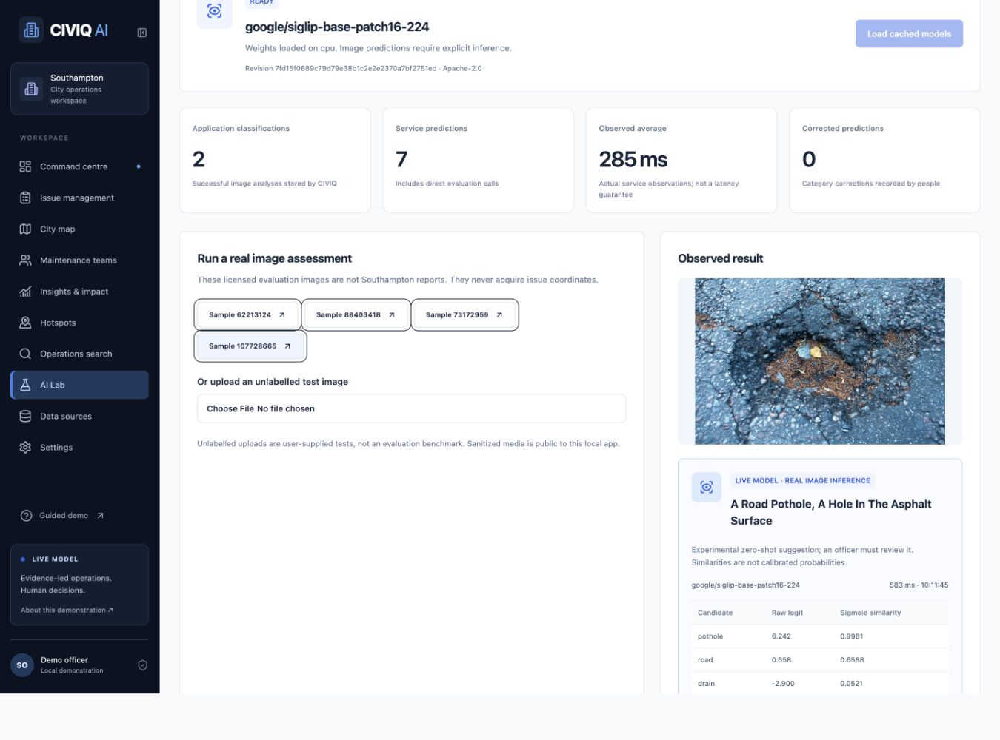 | 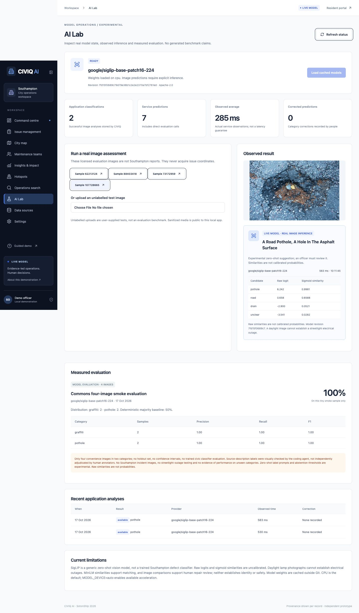           |
| 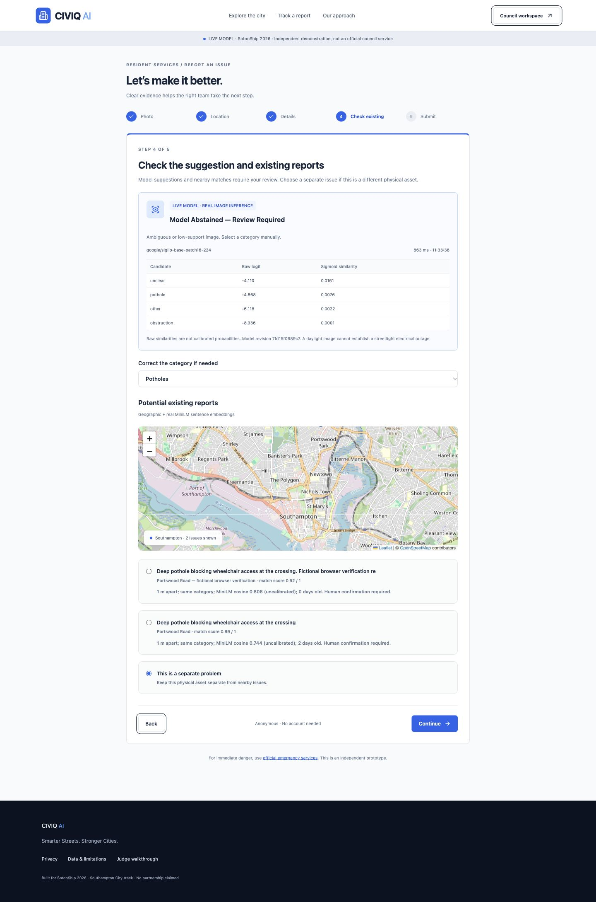                | 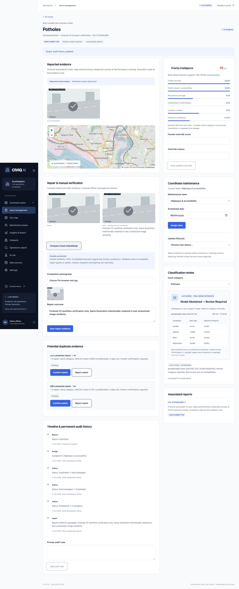    |
| 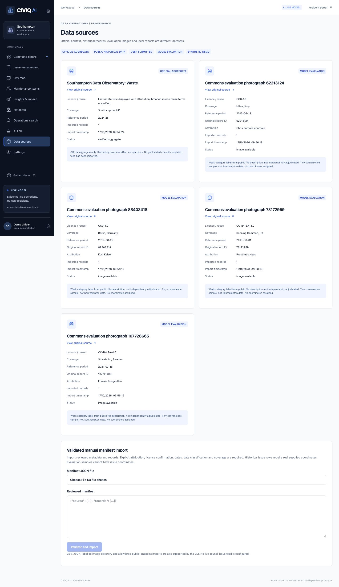                      |      |

## Deployment and limits

`npm run build && npm start` starts the production web build. Production fails closed for staff routes: configure a random `STAFF_TOKEN` of at least 24 characters and enter it in the staff access form. `LOCAL_DEMO=true` bypasses staff auth only in development. This shared-token prototype is not council SSO, a multi-tenant authorisation system or a production-ready public service.

**Next.js deployment does not deploy Python inference.** A public installation needs a separately hosted long-running inference service with persistent model storage, private networking/TLS, a strong matching `INFERENCE_TOKEN`, appropriate resource limits and a reachable server-side `INFERENCE_URL`. Export the token to the Python process as well as Next.js; uvicorn does not automatically read `.env`. Keep the default loopback binding for local use. A Vercel web deployment also needs durable database/media services because local SQLite/uploads do not provide durable shared serverless storage. These integrations are future deployment work, not completed infrastructure.

Experimental: zero-shot labels, thresholds, tiny evaluation, semantic duplicate weights, radial hotspot heuristic and image repair comparison. Implemented operational workflows remain human-reviewed. Future work includes verified council issue feeds/licences, representative adjudicated evaluation, confidence calibration, council SSO, notifications and durable hosted inference/storage.

Source code: [MIT](LICENSE). Model and evaluation-image licences are separate; see manifests and provenance. CIVIQ does not use official council branding or claim council affiliation.
