<p align="center"></p>
<h1 align="center">Smarter Streets. Stronger Cities.</h1>
<p align="center"><strong>The intelligent city maintenance platform</strong><br/>SotonShip 2026 · Southampton City track</p>
<p align="center">Turn a resident’s photograph into coordinated, traceable and verifiable maintenance action.</p>
<p align="center">


</p>
<p align="center"><a href="https://github.com/Advaith-Ganesh/CIVIQ">Source code</a> · <a href="#13-installation-instructions">Run locally</a> · <a href="docs/VERIFICATION.md">Verification evidence</a></p>

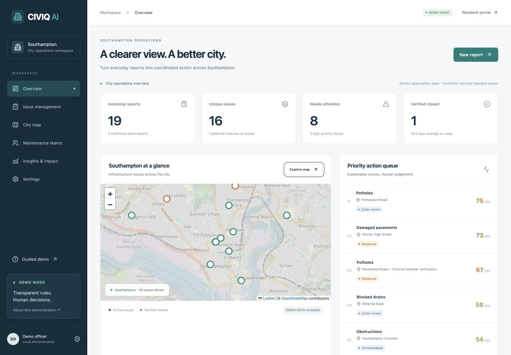

> **Phase 1 · DEMO MODE.** Runs locally without paid API keys or external accounts. Classification and matching are deterministic. Image interpretation and repair verification are human decisions. Seed reports and evidence are fictional. This is an independent demonstration, not an official council service.

## 1. Project overview

CIVIQ AI joins the resident and maintenance journeys in one persistent application. A complaint becomes evidence attached to a canonical issue; the issue receives an explainable priority and follows a team-owned lifecycle through repair and manual verification. Residents can track progress and reopen unresolved outcomes.

The competitive idea is coordinated action and verifiable closure, beyond collecting complaints.

## 2. The Southampton problem

Southampton’s [Data Observatory Waste page](https://data.southampton.gov.uk/place/environment/waste/) reports **47.1 fly-tipping incidents per 1,000 residents in 2024/25**. The page was updated on 29 June 2026 and checked on 17 October 2026. Recording practices affect comparisons; this aggregate is contextual evidence, not a CIVIQ complaint feed.

The brief’s 12,208 incident total was not independently confirmed in the page text and is not presented as a verified figure. All issue locations in the repeatable seed are fictional Southampton examples.

## 3. Our solution

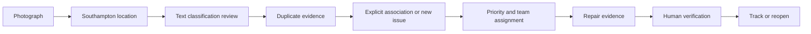

Residents provide evidence without registering. Officers review explanations, coordinate teams and preserve a decision history. The public map and tracking page expose useful operational progress while excluding private staff notes and internal reviews.

## 4. Key features

| Experience | Implemented behaviour |
| --- | --- |
| Resident reporting | Six-step photograph, location, description, classification, duplicate review and submission flow |
| Evidence | JPEG/PNG/WebP validation, 5 MB input limit, image decoding, metadata removal, resizing and local storage |
| Persistence | SQLite relations, tracked migrations and repeatable 18-report seed |
| Matching | Haversine distance, category compatibility, keyword similarity, age, asset identifiers and explicit decisions |
| Prioritisation | Configurable factors, visible breakdown, text safety flags and reasoned officer overrides |
| Maintenance | Team creation/assignment, dates, private notes, controlled statuses, repair evidence and manual closure |
| Resident outcomes | Random tracking references, public timeline, before/after evidence and reopening requests |
| Operations | Search, filters, priority/date sorting, pagination, city maps and workload views |
| Insights | Stored-data charts, duplicate reduction, closure rate, ageing issues and recurrence candidates |
| Trust | Visible demo labels, provenance, limitations, audit events and illustrative ROI assumptions |

## 5. Screenshot gallery

These are **real browser captures of the running application**. Fictional illustrations shown inside the app remain labelled as demo evidence. Screenshots include one explicitly fictional browser verification report in addition to seed data.

| Resident experience | Intelligence & operations |
| --- | --- |
| 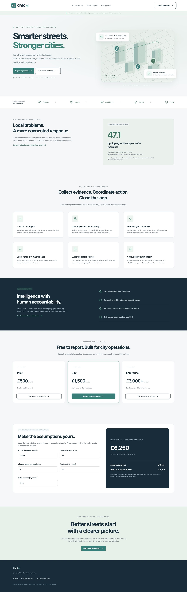 **Landing:** local purpose, workflow and illustrative business model | 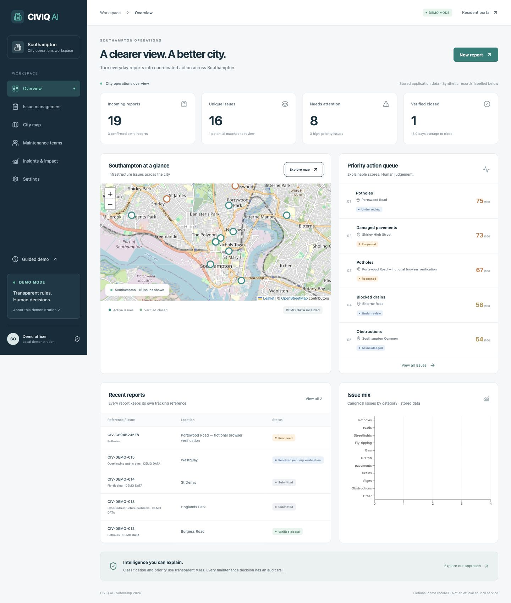 **Operations:** stored metrics and priority queue |
| 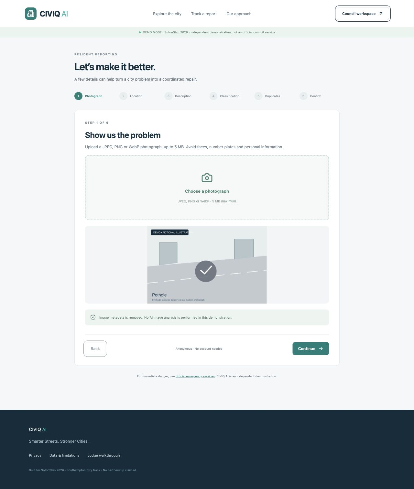 **Reporting:** actual validated local upload | 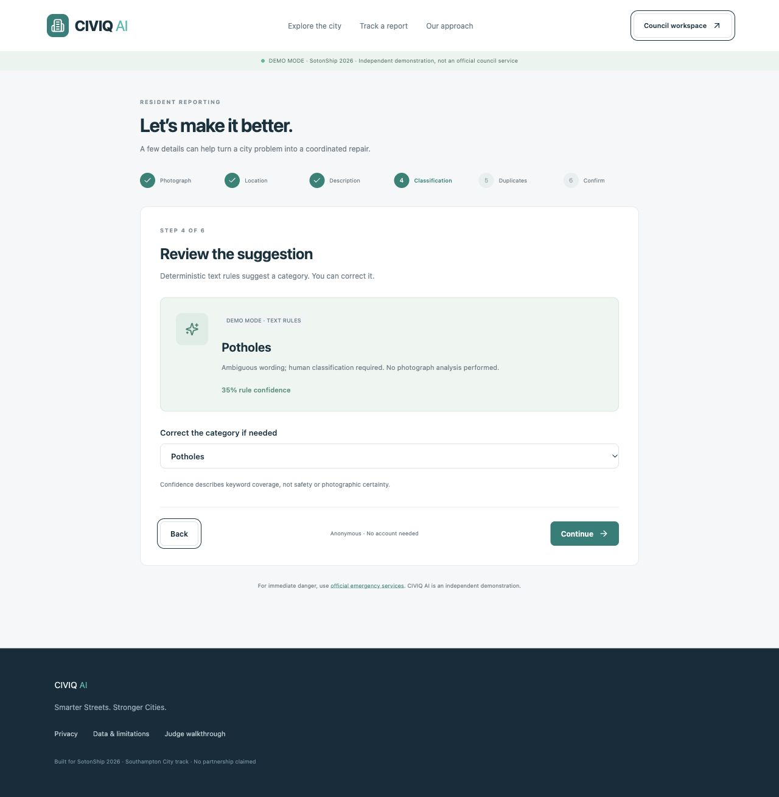 **Classification:** text rules only; no image analysis |
| 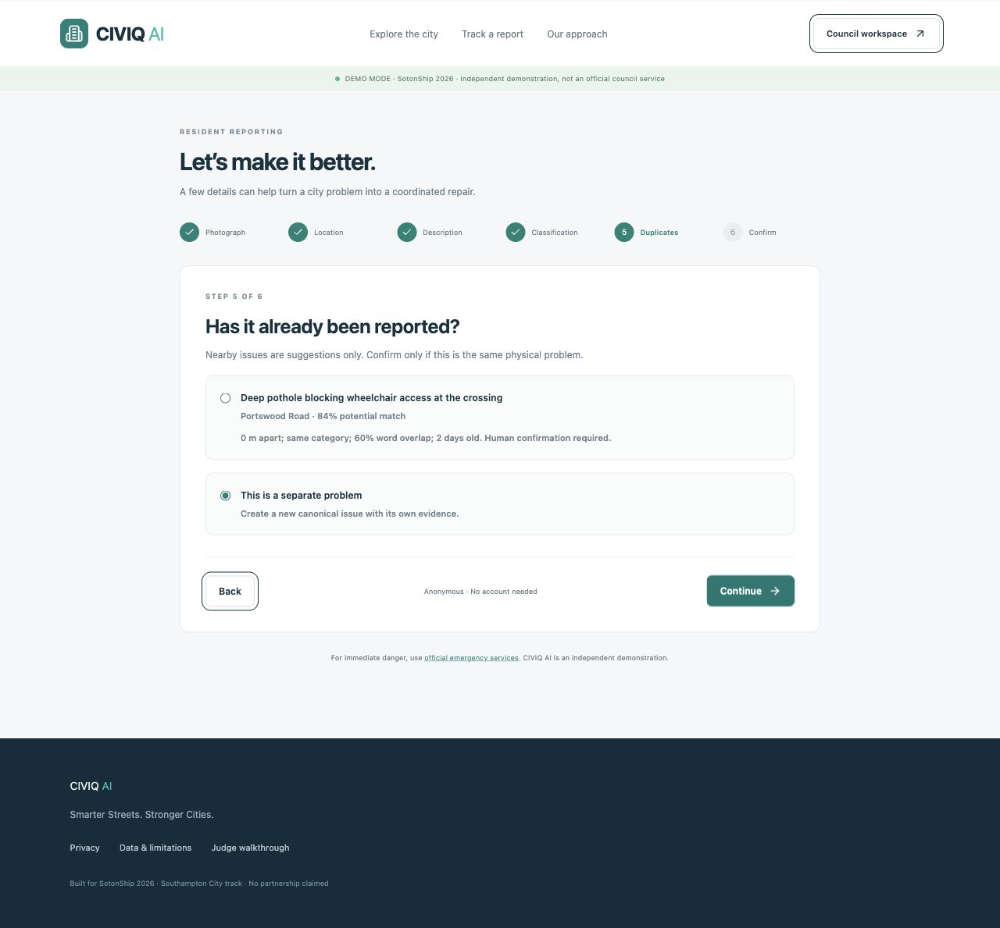 **Matching:** distance, word overlap and explicit decision | 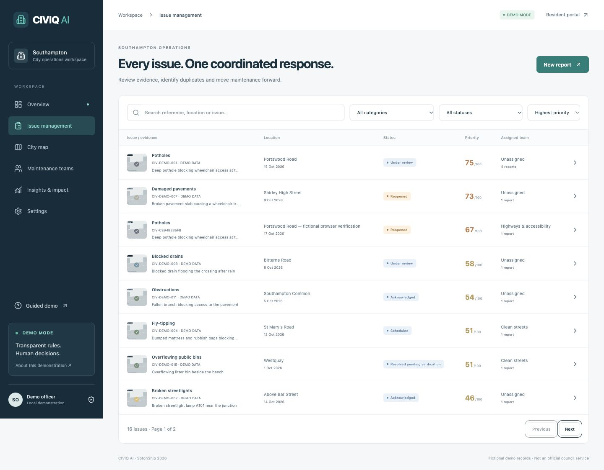 **Management:** searchable, filtered operations table |
| 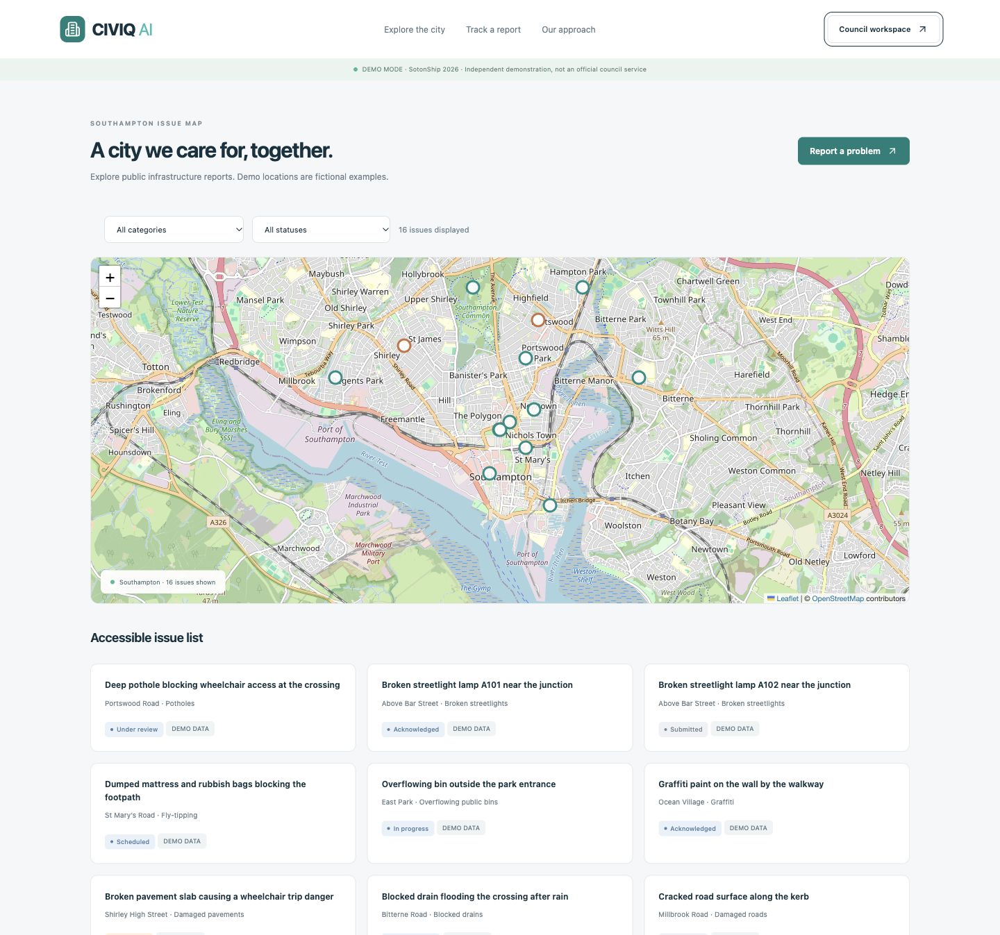 **Map:** fictional Southampton infrastructure examples | 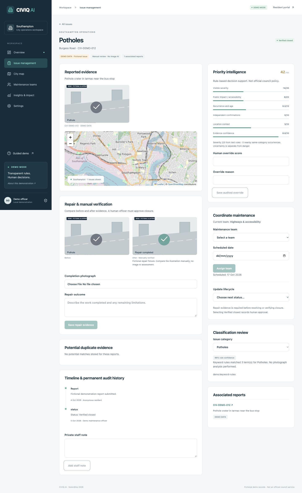 **Verification:** before/after evidence and manual review |
| 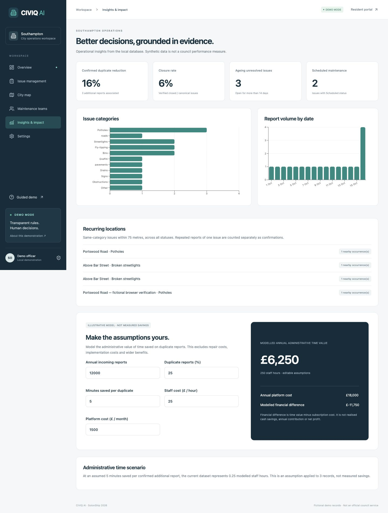 **Insights:** stored data and editable financial assumptions | 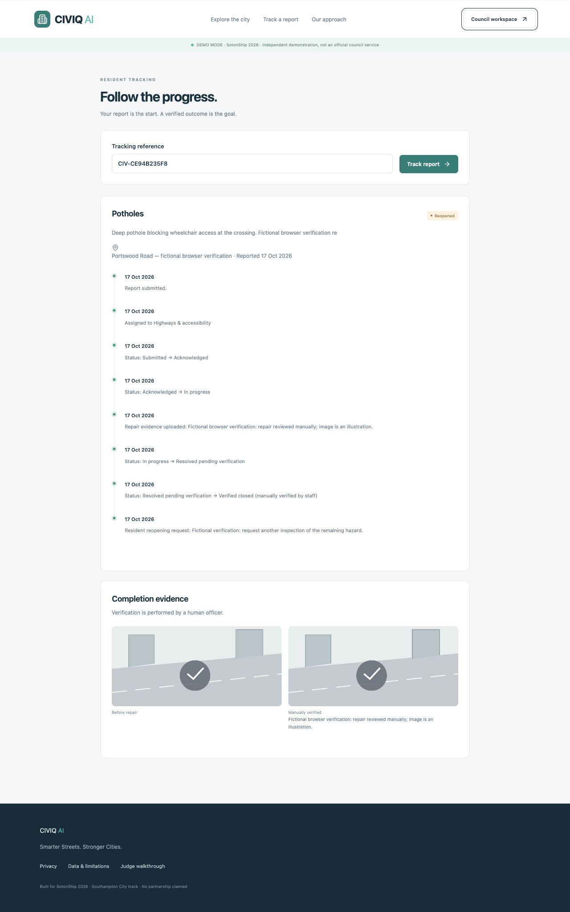 **Outcome:** full timeline and resident reopening |

## 6. Product demonstration

Start locally, then visit `/demo` for a seven-stop judge walkthrough.

- `/report`: submit a new report using a JPEG, PNG or WebP file.
- `/dashboard/issues/demo-1`: one Portswood pothole with four fictional reports.
- `/dashboard/issues/demo-3`: intentionally wrong nearby streetlight match to reject.
- `/dashboard/issues/demo-7`: reopened pavement hazard.
- `/dashboard/issues/demo-12`: manually verified before/after repair fixture.
- `/track?ref=CIV-DEMO-012`: public completion evidence and reopening request.
- `/dashboard/insights`: operational charts and editable financial scenarios.

No hosted live-demo or video URL is claimed. Phase 1 demonstrates the deterministic workflow; genuine AI evaluation requires Phase 2.

## 7. System architecture

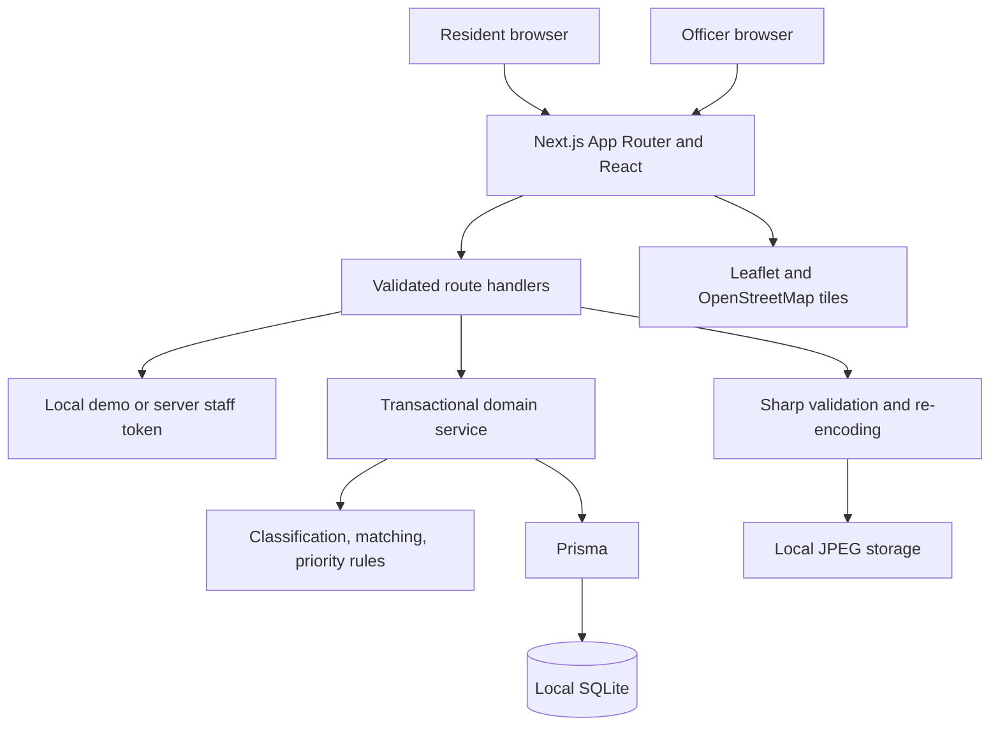

UI modules live in `src/components/`: application shell, resident flow, operations, marketing and shared primitives. `src/lib/service.ts` owns report creation and lifecycle mutations; pure rules are independently testable. Route handlers enforce staff authorization for operations and configuration. The server binds to loopback by default.

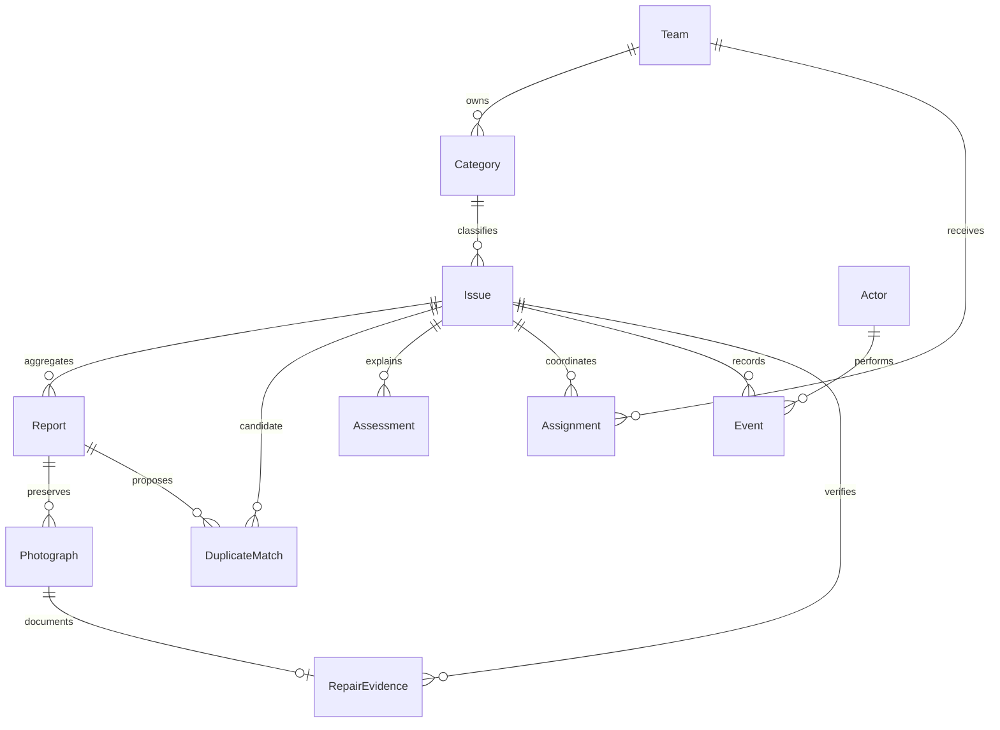

`Event` records status changes, public updates and private audit notes; `kind` distinguishes them. `DatasetSource` holds provenance and `Setting` stores validated scoring configuration. Historical parent issues remain stored when a report is reassociated; empty parents are excluded from the active issue count.

## 8. AI architecture

`AIAdapter` defines text classification, vision, semantic embeddings, multimodal comparison, repair assessment and summarisation boundaries. `DemoAdapter` uses keyword rules and excerpts, explicitly reports unsupported image operations and throws for semantic embeddings.

**No genuine AI service is implemented in Phase 1.** Setting `AI_PROVIDER=openai` fails explicitly instead of returning simulated live results. No photographs are sent to OpenAI. The reserved model variables prepare server configuration for future work.

## 9. Duplicate matching methodology


Default radius: 75 m, configurable from 10–200 m. Temporal cutoff: 90 days. Score is `0.4 × proximity + 0.4 × Jaccard word overlap + 0.1 category match + 0.1 temporal relevance`, capped at 0.95. Candidates below 0.35 are excluded. Common stop words are omitted.

Streetlights with different supplied lamp/column/asset/pole identifiers are separated. Without identifiers, nearby streetlights remain uncertain candidates. There is no automatic merge. Staff reassociation preserves report photographs and original parent audit history; repaired issues must be reopened first. This is not visual or semantic similarity, and scores are not calibrated probabilities.

## 10. Priority calculation

| Factor | Default weight | Phase 1 input |
| --- | ---: | --- |
| Visible severity | 35 | Text-derived severity out of 5; no vision interpretation |
| Public impact/accessibility | 20 | Accessibility and obstruction keywords |
| Recurrence and age | 15 | Issue age and nearby same-category canonical records |
| Independent confirmations | 10 | Additional associated reports; independent identities are not verified |
| Location context | 10 | Neutral 0.5 assumption; no verified context dataset |
| Evidence confidence | 10 | Keyword classification confidence |

Values are bounded from 0 to 1 and weighted into a score out of 100. The UI recalculates with current age, confirmations and settings. Human overrides retain the calculated explanation and require a written reason. Severity and confidence appear separately. Urgent wording flags human review; this is not emergency dispatch or official council policy.

## 11. User journeys

**Resident:** upload → select location → describe → review category → inspect duplicates → submit → retain reference → track → review outcome → request reopening.

**Officer:** inspect queue → review classification and duplicate evidence → assign team/date → record updates → upload repair evidence → verify manually → reopen if required.

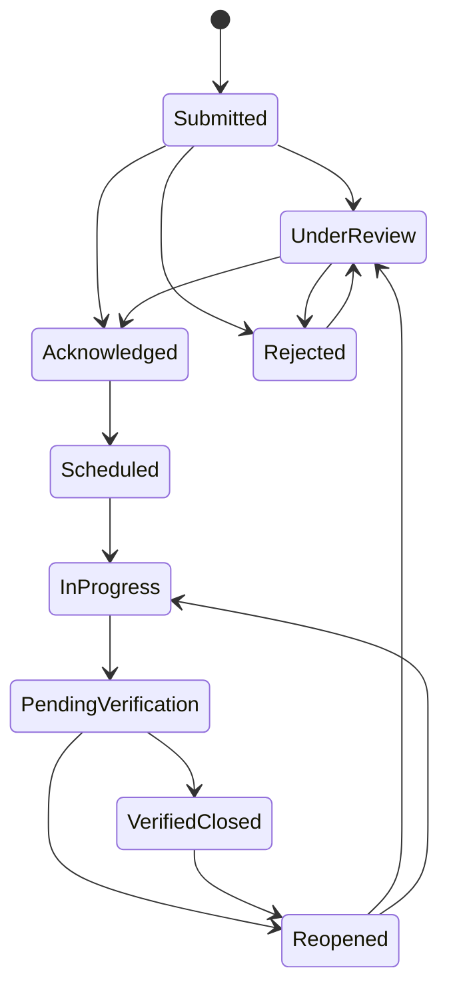

The diagram highlights the principal path; `transitions` in `src/lib/rules.ts` defines all permitted transitions, including returning work to scheduling or acknowledgement. Repair evidence is required for pending verification and closure. Every mutation creates an event.

## 12. Technology stack

Next.js 16 App Router · React 19 · strict TypeScript · Tailwind CSS 4 · shadcn-compatible Radix/CVA button · Lucide · React Hook Form · Zod · Prisma 6 · SQLite · Leaflet/React Leaflet · OpenStreetMap · Recharts · Sharp · Vitest · Playwright.

`package-lock.json` pins the dependency graph. Webpack is explicitly selected because this build host restricts native file watchers. The `deepmerge-ts` override addresses an advisory in Prisma's development configuration dependency; migration and integration tests verify compatibility.

## 13. Installation instructions

Requires Node.js 22 and npm. Tested with Node 22.14.0 on macOS arm64.

```bash
git clone https://github.com/Advaith-Ganesh/CIVIQ.git
cd CIVIQ
npm ci
cp .env.example .env
npm run db:setup
npm run dev
```

Open `http://127.0.0.1:3000`. Installation requires internet; local app records and uploads do not require a cloud account. OpenStreetMap tiles require connectivity.

## 14. Environment variables

| Variable | Purpose |
| --- | --- |
| `DATABASE_URL` | SQLite URL; default `file:./dev.db`, resolved within `prisma/` |
| `AI_PROVIDER` | `demo`; `openai` intentionally fails until a real adapter exists |
| `OPENAI_API_KEY` | Reserved server-only Phase 2 secret; unused in Phase 1 |
| `OPENAI_VISION_MODEL` | Reserved future vision model |
| `OPENAI_EMBEDDING_MODEL` | Reserved future embedding model |
| `LOCAL_DEMO` | Enables example staff access only when exactly `true` and not in production |
| `STAFF_TOKEN` | At least 24 characters for staff API access outside local development demo mode |

`.env`, database files and uploads are ignored by Git. Never add credentials to client code or source control. Provider configuration cannot be changed through browser settings.

## 15. Running locally

```bash
npm run dev
npm run typecheck
npm test
npm run build
npm start
```

`npm start` runs the production build. The local demo authorization bypass is disabled in production even when `.env` says `LOCAL_DEMO=true`; configure a strong `STAFF_TOKEN` and enter it at the workspace access form. It is held in browser session storage. This token gate is a local prototype access mechanism, not full council SSO.

On restricted macOS hosts with file-watcher errors:

```bash
WATCHPACK_POLLING=true npm run dev
```

SQLite lives at `prisma/dev.db`; sanitized JPEG files live under `data/uploads/`. Restarting the server preserves both. Back up these together. Local filesystem persistence requires a persistent server disk and is unsuitable for ephemeral serverless deployment without adaptation.

## 16. Demo mode

`npm run db:seed` is idempotent: 18 synthetic reports across 15 canonical issues. Seed evidence is labelled SVG illustration, never presented as real incident photography. Normal user uploads cannot be SVG.

The settings page resets fictional records only after entering `RESET DEMO`, and only in local development demo mode. Seed issues with real resident reports or candidate links are retained to preserve those reports and their evidence. User submissions, team configuration and scoring settings are not wiped.

## 17. Switching to real AI

Phase 2 is **not operational**. Implement a server-side adapter, choose validated model identifiers, add provider error handling and privacy controls, then evaluate it with consented data. Setting the environment variables alone does not enable AI.

Required future evaluation includes category accuracy, duplicate precision/recall, distinct-asset failure rates, confidence calibration, repair-assessment reliability, cost and latency. No trained-model performance is claimed for Phase 1.

## 18. Data sources and provenance

- [Southampton Data Observatory: Waste](https://data.southampton.gov.uk/place/environment/waste/) — official aggregate context; 2024/25; page updated 29 June 2026; checked 17 October 2026.
- [OpenStreetMap contributors](https://www.openstreetmap.org/copyright) — map tiles and attribution; not a council issue dataset.
- `prisma/seed.ts` — original fictional issues, locations, descriptions and timeline fixtures.
- `public/demo/` — original synthetic evidence illustrations.
- Local reports — user-entered evidence, explicitly separate from synthetic seed labels.

The demo boundary is a rectangle around Southampton, **not** official administrative geometry. No restricted dataset was scraped and no public webpage is treated as an undocumented complaint API.

## 19. Testing and evaluation

```bash
npm run typecheck
npm test
npx playwright install chromium
npm run test:e2e
npm run build
npm audit
```

The E2E runner creates an isolated `prisma/e2e.db`, starts a server on port 3001 and exercises upload-to-reopening, duplicate preservation/rejection, invalid inputs, every public/council route and mobile overflow checks. Unit/integration tests create a separate `prisma/test.db`. They do not reset the local developer database.

**Executed results:** 26 Vitest tests pass; strict TypeScript and production build pass. The local Playwright run passed its API-only test; three browser tests were blocked by macOS sandbox Chromium-launch restrictions, not declared passed. The full flow was separately executed in Codex’s supported browser, including private-note exclusion and resident reopening. See [the detailed verification record](docs/VERIFICATION.md).

GitHub Actions is configured to repeat setup, type checking, tests, build and the full Playwright suite on an Ubuntu runner. No CI result is claimed until a run completes.

## 20. Security and Responsible AI

Implemented controls include server-side validation, file signatures plus image decoding, pixel limits, re-encoding and metadata stripping, random media names, path validation, a process-local write limiter, same-host Origin checks, transactional report creation, staff authorization outside local demo mode and private/public event separation.

The default server binds to loopback. The write limiter allows 60 requests per minute per apparent client IP; it is intended for this local single-process demonstration, not distributed abuse defence. Uploaded issue evidence is public by design. Unattached uploads persist until operator cleanup. No automatic moderation or retention scheduler exists.

Officers approve classifications, duplicate associations, priority overrides and repair closure. Evidence confidence is not danger certainty. Immediate danger belongs with [official emergency services](https://www.gov.uk/contact-emergency-services), not this demonstration.

## 21. Business model and pricing

Residents report free. Councils or maintenance contractors are the proposed paying users.

| Proposed tier | Illustrative monthly price | Intended positioning |
| --- | ---: | --- |
| Pilot | £500 | A bounded operational pilot |
| City | £1,500 | One city operations workspace |
| Enterprise | £3,000+ | Configurable multi-area operations |

These are hypotheses, not commercial offers or contracted commitments.

## 22. Cost assumptions

The interactive calculator uses annual reports, duplicate percentage, minutes saved per duplicate, staff hourly cost and monthly subscription price.

`hours = reports × duplicate percentage × minutes / 60`

`administrative time value = hours × hourly cost`

`financial difference = time value − 12 × monthly subscription`

This is modelled administrative value, not realised cash savings, annual contribution or net profit. Hosting, onboarding, support, image storage, repair work and future model costs are excluded. Phase 1 has no paid AI usage.

## 23. Scaling beyond Southampton

A second-city pilot would validate official boundary geometry, map defaults, local evidence sources, service categories, keyword vocabulary, priority policy and maintenance-team ownership. Database category/team configuration already supports local variation; boundary constraints and map defaults currently require code changes.

Before expansion, add production identity, tenancy, verified privacy rules, resilient storage, moderation, retention, backups, operational support and evaluated integrations. No partnership is assumed.

## 24. Limitations

- No genuine image AI, embeddings, semantic matching or automated repair verification.
- Rule scores are decision aids, not calibrated probabilities or council policy.
- Anonymous submissions cannot establish unique independent reporter identities.
- Nearby same-category records are recurrence candidates, not proven repeat defects.
- No official council complaint feed, asset registry or administrative boundary.
- No marker clustering; a list alternative and filters accompany the small demo map.
- Token-based prototype access, no SSO, role hierarchy or multi-tenant deployment.
- Process-local rate limiting, public media, no automatic moderation or retention cleanup.
- Audit events are append-only through the app, not cryptographically tamper-proof.
- One local SQLite database; no production performance or availability claims.
- Local standalone Playwright browser execution is blocked on the build host; full CI result pending.

## 25. Future roadmap

1. Complete and evaluate genuine server-side AI adapters.
2. Integrate consented council/asset data and authoritative city boundaries.
3. Add production identity, tenancy, moderation and retention workflows.
4. Evaluate duplicate confidence calibration and repair assessment with humans.
5. Add clustering, accessible map navigation enhancements and measured operational trials.
6. Validate pricing and delivery costs with potential operators before commercial claims.

## 26. Hackathon details

Prepared for **SotonShip 2026, Southampton City track**, as specified in the project brief. Phase 1 emphasises a working local resident-to-maintenance foundation, explainable methods, commercial assumptions and responsibility. No award, endorsement, official participation verification or customer relationship is claimed.

## 27. AI development disclosure

Codex generated and iterated the application code, schema, seed fixtures, design, tests and documentation during this build session. It executed local tests and used a real browser to validate workflow and capture screenshots. No independent human code review or user research is claimed.

Runtime “intelligence” consists of explicitly labelled deterministic rules. No external model or paid API is called. Original CSS/SVG illustrations and an adapted shadcn-compatible button were created for this implementation; open-source packages are reused as listed in the stack and lockfile. This disclosure describes this implementation session and does not claim when an external hackathon officially began.

## 28. Team and acknowledgements

Maintained in [Advaith-Ganesh/CIVIQ](https://github.com/Advaith-Ganesh/CIVIQ). Team membership beyond the repository owner is not asserted.

Acknowledgements: Southampton Data Observatory for public aggregate context; OpenStreetMap contributors; the maintainers of Next.js, React, Prisma, SQLite, Leaflet, Tailwind, shadcn/ui, Radix, Lucide, React Hook Form, Zod, Recharts, Sharp, Vitest and Playwright.

## 29. Licence

Application source is licensed under the [MIT Licence](LICENSE). Dependency licences and external data/map attribution remain applicable. The software is supplied without warranty and is not an official council system.
